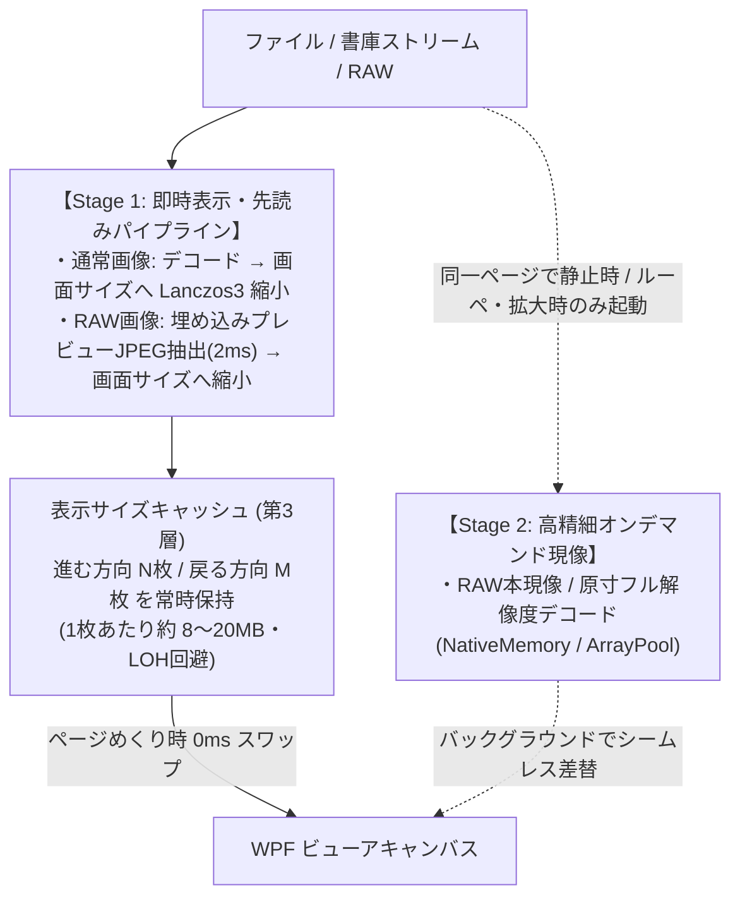

# MangaMeYeah! 技術設計書：ライブラリ選定・メモリ制御・開発フェーズ（確定版）

## 1. ライセンスとライブラリ構成（確定）

* **MangaMeYeah! 本体ライセンス**: **MIT License**
  * 本家 MangaMeeya がかつて直面した「GPL ライブラリとプロプライエタリコンパイラ（Intel C++ ランタイム）のライセンス衝突問題」を完全に回避するため、依存ライブラリも **MIT / Apache-2.0** を中心としたクリーンな構成に統一します。

### 採用ライブラリ一覧

| 分野 | 採用ライブラリ | ライセンス | 役割・選定理由 |
| :--- | :--- | :--- | :--- |
| **メイン画像処理・縮小** | **WIC (OS標準) + SkiaSharp + PhotoSauce.MagicScaler** | **MIT** | JPEG, PNG, WebP, GIF, BMP, TIFF 等の超高速デコードおよび SIMD 最適化 Lanczos3 リサイズ。`Span<byte>` / `ArrayPool` と直結でき、NetVips のような巨大な LGPL ネイティブ DLL 群も不要。 |
| **多形式フォールバック & RAW** | **Magick.NET (ImageMagick)** + **MetadataExtractor** | **Apache-2.0** | PSD, JPEG XL (JXL), AVIF, HEIC, およびデジカメ各社 RAW（埋め込みプレビュー抽出＆本現像）を単一パッケージ群で網羅。 |
| **SVG ベクター描画** | **Svg.Skia** | **MIT** | ウィンドウサイズ・ルーペ倍率に応じたジャギーのないリアルタイム SVG ラスタライズ。 |
| **書庫・PDF 展開** | **SharpCompress** / **PDFtoImage** | **MIT** | ZIP/CBZ, RAR/CBR, 7z, TAR, PDF のオンメモリストリーム展開。 |
| **動画再生** | **LibVLCSharp.WPF** (または OS標準 `MediaPlayer`) | **LGPL-2.1** (動的リンク) | フォルダ・書庫内動画（MP4, WebM 等）の別ウィンドウ／オーバーレイ再生。 |
| **レトロ形式（切り札）** | **Susie プラグインブリッジ (Rust / C#)** | **MIT** (自作部) | `.spi` (32bit) / `.sph` (64bit) を別プロセスまたは動的ロードで呼び出し。 |

---

## 2. メモリ制御・先読みキャッシュ設計（RAW 2段階ロード統合）

現代の巨大画像（高画素デジカメ RAW や高解像度イラスト：1枚あたり非圧縮 100MB〜380MB）でも MangaMeeya 同様の「0ms ページめくり」を実現するため、本家の「キャッシュ設定（`Dialog ID: 1510`）」を以下のように現代化します。

### 2-1. 3層キャッシュ ＋ RAW 2段階ロードのパイプライン

### 2-2. メモリ管理のコア原則（C# .NET 8）
1. **LOH（Large Object Heap）断片化の完全防止**:
   * デコード用の一時バッファには `new byte[]` を使わず **`ArrayPool<byte>.Shared`** およびアンマネージドメモリ（`SKBitmap` / `NativeMemory`）を使用し、何千枚めくっても GC の一時停止（引っかかり）を起こさない。
2. **「枚数指定」×「メモリ容量上限（MB/GB）」のハイブリッド管理**:
   * 本家同様の「先読み枚数（進む方向／戻る方向）」に加え、「キャッシュ制限容量（例：デフォルト `2048 MB`、設定で変更可）」を超えた場合は古いキャッシュから自動破棄（LRU）する。

---

## 3. クイックセーブの進化：「サムネイル一覧での複数選択＆コレクション処理」

ThumbsPlus 8J の「Access DB 2GB 制限により極小サムネイルしか使えず、サムネイル上で選別・コレクション処理ができない」という課題を解決するため、**MangaMeYeah! のサムネイル表示モード（1画面／8列／カスタム列）を「高速選別（ライトテーブル）画面」として強化**します。

### 2つの選別・コレクションワークフロー
1. **単ページ／見開き閲覧中の即時振り分け（従来スタイル）**:
   * 画像を大きく表示しながら、右ドラッグの4方向2ストロークジェスチャ（左上・右上・左下・右下）やショートカットで **クイックセーブ 1〜4（さらに 5〜9 へ拡張可能）** の保存先フォルダへ即座にコピー／移動。
2. **サムネイル一覧モードでの複数選択・一括コレクション処理（新規強化）**:
   * キー（`A` / `H`）やジェスチャ（`→`）でビューア画面を高精細サムネイル一覧（ホイールや設定でサムネイルサイズ自在変更）に切り替え。
   * サムネイル上で **`Ctrl` / `Shift` クリック、スペースキー、範囲ドラッグで複数の画像を選択（チェックマーク付与）**。
   * 選択した複数画像に対して、そのまま **一括クイックセーブ（指定フォルダへのコピー／移動）、お気に入り・プレイリスト登録、タグ付け** を実行可能にする。
   * ※ ビューアから1クリックで「大判確認」⇔「サムネイル複数選択」を行き来できるため、重たいデータベースを持たずに選別作業が完結します。

---

## 4. 開発フェーズ（Phase 2 優先ロードマップ）

| フェーズ | マイルストーン目標 | 主な実装項目 |
| :--- | :--- | :--- |
| **Phase 1** | **コア表示＆爆速ページめくり基盤 (MVP)** | ・フォルダ／単体画像の読込（`__MACOSX`, `._*`, `.DS_Store` 自動除外、自然順ソート） ・1ページ／2ページ見開き表示（右開き・左開き・自動見開き） ・スケールモード各種 ＋ `MagicScaler` / `SkiaSharp` による Lanczos3 高品質縮小 ・`ArrayPool` ベースの先読み・リサイズキャッシュエンジン ・基本キー操作（矢印、`Home`/`End`、`Space`、`Alt+Enter` フルスクリーン） |
| **Phase 2** *(優先)* | **マウス操作・ジェスチャ・クイックセーブ＆サムネイル選別** | ・**MangaMeeya マウス入力エンジン**: 左右クリック、長押し（左長押し終了・右長押し1/2頁切替）、同時押し（左/右＋ホイール等）、第4/第5ボタン ・**マウスジェスチャエンジン**: 右ドラッグ軌跡判定（4方向2ストロークによるクイックセーブ1〜4等） ・**ルーペ表示**: 丸型/四角型、右＋ホイールでのルーペ倍率変更 ・**クイックセーブ 1〜4＋サムネイル表示モード（複数選択からの一括クイックセーブ対応）** |
| **Phase 3** | **書庫（ZIP/RAR/7z/PDF）＆ RAW・SVG・多形式対応** | ・オンメモリ書庫展開（`SharpCompress` / PDF）＋ 前後の書庫移動 ・**デジカメ RAW 2段階高速ロード**（埋め込みプレビュー即時表示 ＋ バックグラウンド本現像） ・SVG ベクター表示、AVIF / JXL / PSD 対応 ・Susie プラグイン（`.spi` / `.sph`）ブリッジ（Rust 連携） |
| **Phase 4** | **MangaMeYeah! 独自キラー機能（アイデアノート実装）** | ・**関連画像のジャンプ**: 連続プレフィックス（作者・シリーズ）の先頭／末尾へジャンプ ・**画像連結表示**: X（旧Twitter）の3枚・4枚分割投稿の縦・横・2×2連結表示 ・**動画再生ウィンドウ連携**: フォルダ・書庫内の動画を別窓／オーバーレイ再生 |
| **Phase 5** | **お気に入り・プレイリスト ＆ Everything リンク修復** | ・お気に入り・履歴・しおり管理（アーカイブ高速ハッシュ記録） ・**Everything 連携によるリンク切れ自動修復**（同名検索＋ハッシュ照合） ・外部プログラム起動および将来の ThumbsPlus 8J 代替アプリとの連携機構 |
| **Phase 6** | **設定 UI 整備・メニュー整理・v1.0 パッケージング** | ・環境設定・キャッシュ設定・マウス／キー設定ダイアログの実装（`MangaMeeya.ini` インポート対応） ・不要メニュー項目の整理、フィルタ／回転プロファイル整備、リリースビルド作成 |
