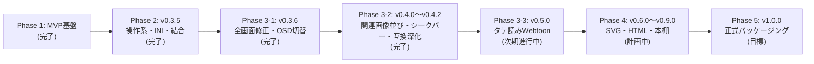

# MangaMeYeah! 総合ロードマップ (Master Roadmap)

本書は、**MangaMeYeah!** の開発計画、機能追加ロードマップ、および将来構想（アイデアノートやユーザーフィードバックに基づく拡張機能）を体系的にまとめた確定版ロードマップです。

---

## バージョニング規約 (Versioning Policy)
本プロジェクトでは、開発の進捗とユーザーへのわかりやすさを両立するため、以下の明確なバージョニング規約を採用しています：
- **目玉機能（キラー機能）の追加ごとにマイナーバージョンをアップ（`0.x.0`）**
  - 例: v0.4.0（関連画像並びジャンプ）→ v0.5.0（タテ読みモード）→ v0.6.0（SVG表示対応）
- **バグ修正・小規模改善・ドキュメント整備はパッチバージョンをインクリメント（`0.x.y`）**

---

## 開発フェーズとマイルストーン概要

---

## 各フェーズの詳細実装項目

### Phase 1: コア表示＆爆速ページめくり基盤 (MVP) 【完了】
- [x] フォルダ・単体画像の読込、Unicode / ロングパス対応
- [x] macOS メタデータ（`__MACOSX`, `._*`）等の自動除外
- [x] 1ページ表示・2ページ見開き表示（右開き／左開き）
- [x] スケールモード各種（原寸、ウィンドウ合わせ、横幅合わせ、縦幅合わせ、縮小専用）
- [x] `MagicScaler` / `SkiaSharp` による Lanczos3 高品質リサイズ
- [x] `ArrayPool` ベースのメモリ管理と先読み・リサイズキャッシュエンジン
- [x] キーボードナビゲーション（矢印キー、`Home`/`End`、`PageUp`/`PageDown`、`Space`、`Alt+Enter`）

### Phase 2: 操作系・INI 永続化・自動結合 (v0.3.5) 【完了】
- [x] **MangaMeeya マウス入力エンジンの完全再現**:
  - 左右クリック送り・戻り
  - 左右長押し 500ms（左長押し即時終了、右長押し単ページ/見開きトグル）
  - コード操作（右押しながら左クリック、左押しながら右クリック）
  - 右ドラッグマウスジェスチャーによるクイックセーブ 1〜4
  - ルーペ拡大鏡（円形／矩形、右ドラッグ／右＋ホイール倍率変更）
- [x] **書庫・階層構造の完全サポート**:
  - オンメモリ書庫展開（ZIP, RAR, 7z, CBZ, CBR, TAR）
  - 書庫内書庫（ネスト書庫）の再帰的メモリストリーム展開
  - MangaMeYeah!式 階層自然順グループソート
  - 兄弟フォルダ先行探索による巻またぎ 0ms 移行
- [x] **X（旧Twitter）連結・多分割画像の24通り全探索自動パズル復元**:
  - 2分割、3分割、4分割、2×2グリッド
  - 白余白・単色背景の誤検出防止フィルター（`seamStdDev >= 7.0`）
- [x] **`MangaMeYeah.ini`（UTF-8 BOMなし）設定保存 & レジューム記憶**:
  - レジストリ不要のポータブル運用
  - フォルダ・書庫ごとの閲覧終了ページ自動記憶
- [x] **ライトテーブルサムネイル一覧画面**:
  - `VirtualizingStackPanel` による UI 仮想化（大規模フォルダでも省メモリ）
  - 同心円状優先バックグラウンドデコード
  - 複数選択と一括クイックセーブ
- [x] **エクスプローラー連携 (HKCU)**:
  - 管理者権限不要の右クリック「マンガミーヤーで開く」登録・解除
- [x] **公式ロゴ・5:2 バナー画像の策定 & 初の公式プレビュー版（v0.3.5）公開**

### Phase 3-1: 安定化・全画面修正・ドキュメントスイート (v0.3.6) 【完了】
- [x] **マルチモニター/高DPI環境でのフルスクリーン表示根本修正**:
  - Windows DWM 最大化枠食い込みの解消（メニューバー上部22px欠け・下部隙間の完全排除）
- [x] **「表示(_V)」メニューへの設定トグル追加**:
  - OSDテキスト表示切替、マウスジェスチャートレイル表示切替（INI永続化）
- [x] **公式ドキュメントスイート策定**:
  - 機能設計書 (`docs/spec/functional_spec.md`)
  - アーキテクチャ設計書 (`docs/spec/architecture_and_components.md`)
  - テスト仕様書 (`docs/test/test_specification.md`)：MangaMeeya 7.4b 全メニューID監査
  - 総合ロードマップ (`docs/roadmap/roadmap.md`)
- [x] **ブランド表記「MangaMeYeah!」および公式ベクターSVGロゴ・透過ロゴの完全統一**

### Phase 3-2: 目玉機能「関連画像並びジャンプ」 (v0.4.0) 【完了】
- [x] **関連画像並びジャンプの実装**:
  - `Ctrl + Home`: 関連画像並び先頭へ（先頭時は前の関連画像並び先頭へ高速巻き戻し）
  - `Ctrl + End`: 関連画像並び最後尾へ（末尾時は次の関連画像並び先頭へ高速スキップ）
  - メインメニューバーおよびコンテキストメニュー「移動(_J)」へのメニュー項目追加
  - 多彩な命名規則（Twitter Downloader, 角括弧, アンダースコア, 連番）の自動プレフィックス判定
  - MangaMeeya デフォルト設定との完全な共存（`→→` / `←←` などの既存ジェスチャーや固定ページ送りと無競合）

### Phase 3-2.1: 連結画像検出トグル＆永続化 (v0.4.1) 【完了】
- [x] **「表示(_V)」メニュー最下部に「連結画像検出(_C)」トグル設定を追加**:
  - メインメニューおよび右クリックメニュー最下部（OSD表示・ジェスチャー軌跡表示の直下）へ直接配置。
  - 切り替え時に `MangaMeYeah.ini` の `AutoDetectConnectedImages` に即時永続保存し、次回起動時も状態を完全復元。
  - レ点チェック状態のリアルタイム同期。
  - OFF 設定時の不要な背景画像解析および問い合わせダイアログの抑止。

### Phase 3-2.2: ボトムシークバー・レトロ/モダン切替・MangaMeeya 互換性深化 (v0.4.2) 【完了】
- [x] **最下行シークバー（ボトムシークバー）の実装**:
  - 画面下端ホバーでポップアップするシークバー（ページ送り・トラックバー・ページ数・サムネイル・ソート・見開き方向・1/2ページ・スケール切替）を実装。
- [x] **メニューおよびシークバーのレトロ / モダンスタイル切替**:
  - レトロ（`MS UI Gothic` 9pt、Win32 3D ボタン、MangaMeeya 互換メニュー項目のみ表示）とモダン（メイリオ/Yu Gothic UI、MangaMeYeah! ロゴカラー）の切り替えに対応。
- [x] **特定フォルダーでの連結画像検出自動ON (`connected_folders.txt`)**:
  - 登録フォルダー（サブフォルダー含む）を開いた際に連結画像検出を自動で ON に切り替え。
- [x] **「書庫のみ開く (`OpenArchivesOnly`)」および「表示位置記憶（モードA: `RememberPagePosition`）」の実装**
- [x] **v0.4.1 デバッグ指摘8項目の完全解消**:
  - 全画面メニューバー余白修正、`マンガミーヤーで開く` 統一、`関連画像並び` への改称、自動見開き復帰・50%幅判定、ルーペ描画＆画面端クランプ、クイックセーブ上書き確認、外部ファイル削除耐性、画像情報ダイアログの書庫情報・横幅リサイズ・ツールチップ対応。

---

### Phase 3-3: 次期目玉機能群 (v0.5.0〜v0.8.0) 【進行中・計画中】
1. **タテ読み（Webtoon / manhwa）モードの設計・実装 (v0.5.0)** 【次期目標】:
   - 縦長スクロールビューアーモード（中央レーン方式、最大表示幅設定、継ぎ目ゼロ結合、完全手動切替）。
2. **SVG ベクター画像表示対応 (v0.6.0)**:
   - `Svg.Skia` の導入により、企業ロゴやベクター画像を拡大しても一切ジャギーのない無限解像度でレンダリング。
   - Google Keep ロゴ管理ワークフローとの連携。
3. **オフライン用ローカル HTML ヘルプの生成 (v0.7.0)**:
   - ネット接続のない環境でもブラウザで快適に読めるローカル HTML ヘルプの自動ビルド。
   - オフライン表示であることを明示するデザインヘッダー付与。
4. **メニュー表示モード切替（レトロ ⇔ モダン）** 【v0.4.2 前倒し実装完了】:
   - MangaMeeya 7.4b 互換の「レトロモード」と「モダンモード」を環境設定から瞬時切替。
5. **連結画像「未検出モード（OFF / 手動トグル）」 & `connected_folders.txt`** 【v0.4.1 / v0.4.2 実装完了】:
   - メニュー「表示」最下部に「連結画像検出」トグルを配置し、INI永続化とフォルダー別自動ONに対応。
6. **簡易画像変換エクスポート**:
   - 表示中の画像（SVG, WebP, AVIF, RAW 等）を PNG / JPEG として即座に別名保存（Google Keep 貼付用など）。

---

### Phase 4: コミック特化ライブラリ＆高度機能 (v0.5.x〜v0.8.x) 【計画中】
MangaMeeya の精神的後継として、オールドファン待望のライブラリ機能や独自キラー機能群を段階的に実装します。

1. **本棚（Bookshelf）ビュー**:
   - コミック書庫やフォルダの表紙画像をグリッド状に並べ、仮想本棚として視覚的に管理・開閉。
2. **しおり（マーキング）＆お気に入り（プレイリスト）**:
   - 任意のページにしおりを挟み込み、素早くジャンプ。
   - アーカイブのハッシュ値と紐付けたお気に入りコレクション管理。
3. **書庫内インデックス機能**:
   - 圧縮 Zip 内の各話・章の境界を検知またはメタデータ付与し、目次から各話先頭へダイレクトジャンプ。
4. **関連画像並びジャンプ** 【v0.4.0 / v0.4.2 実装完了】:
   - 連続するファイル名プレフィックス（作者名・シリーズ名等）の先頭／末尾へ瞬時にジャンプ。
5. **動画再生連携**:
   - フォルダや書庫内に混在する動画（MP4, WebM 等）を別ウィンドウまたはオーバーレイで直接シームレス再生。
6. **Everything 連携によるリンク切れ自動修復**:
   - ファイル名検索およびハッシュ照合により、ドライブ間移動後も履歴やお気に入りのリンク切れを自動修復。
7. **Susie プラグインブリッジ (`.spi` / `.sph`)**:
   - 往年のレトロ画像フォーマット・独自圧縮書庫のロードに対応。

---

### Phase 5: v1.0.0 正式リリースへ向けたパッケージング & 安定化 【目標】
- [ ] 全機能の網羅的自動テスト・リグレッションテストのパス
- [ ] インストーラー（Inno Setup / MSIX）の署名・自動更新チェック機構
- [ ] 「「MangaMeeya」の至高の操作感を目指して！」から、満を持しての「**「MangaMeeya」の至高の操作感を現代に！**」への昇格
