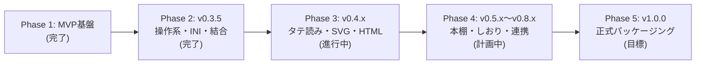

# MangaMeYeah! 総合ロードマップ (Master Roadmap)

本書は、**MangaMeYeah!** の開発計画、機能追加ロードマップ、および将来構想（アイデアノートやユーザーフィードバックに基づく拡張機能）を体系的にまとめた確定版ロードマップです。

---

## 開発フェーズとマイルストーン概要

---

## 各フェーズの詳細実装項目

### Phase 1: コア表示＆爆速ページめくり基盤 (MVP) 【完了】
- [x] フォルダ・単体画像の読込、Unicode / ロングパス対応
- [x] macOS メタデータ（`__MACOSX`, `._*`）等の自動除外
- [x] 1ページ表示・2ページ見開き表示（右開き／左開き）
- [x] スケールモード各種（原寸、ウィンドウ合わせ、横幅合わせ、縦幅合わせ、縮小専用）
- [x] `MagicScaler` / `SkiaSharp` による Lanczos3 高品質リサイズ
- [x] `ArrayPool` ベースのメモリ管理と先読み・リサイズキャッシュエンジン
- [x] キーボードナビゲーション（矢印キー、`Home`/`End`、`PageUp`/`PageDown`、`Space`、`Alt+Enter`）

### Phase 2: 操作系・INI 永続化・自動結合 (v0.3.5) 【完了】
- [x] **MangaMeeya マウス入力エンジンの完全再現**:
  - 左右クリック送り・戻り
  - 左右長押し 500ms（左長押し即時終了、右長押し単ページ/見開きトグル）
  - コード操作（右押しながら左クリック、左押しながら右クリック）
  - 右ドラッグマウスジェスチャーによるクイックセーブ 1〜4
  - ルーペ拡大鏡（円形／矩形、右ドラッグ／右＋ホイール倍率変更）
- [x] **書庫・階層構造の完全サポート**:
  - オンメモリ書庫展開（ZIP, RAR, 7z, CBZ, CBR, TAR）
  - 書庫内書庫（ネスト書庫）の再帰的メモリストリーム展開
  - MangaMeYeah!式 階層自然順グループソート
  - 兄弟フォルダ先行探索による巻またぎ 0ms 移行
- [x] **X（旧Twitter）連結・多分割画像の24通り全探索自動パズル復元**:
  - 2分割、3分割、4分割、2×2グリッド
  - 白余白・単色背景の誤検出防止フィルター（`seamStdDev >= 7.0`）
- [x] **`MangaMeYeah.ini`（UTF-8 BOMなし）設定保存 & レジューム記憶**:
  - レジストリ不要のポータブル運用
  - フォルダ・書庫ごとの閲覧終了ページ自動記憶
- [x] **ライトテーブルサムネイル一覧画面**:
  - `VirtualizingStackPanel` による UI 仮想化（大規模フォルダでも省メモリ）
  - 同心円状優先バックグラウンドデコード
  - 複数選択と一括クイックセーブ
- [x] **エクスプローラー連携 (HKCU)**:
  - 管理者権限不要の右クリック「MangaMeYeah!で開く」登録・解除
- [x] **公式ロゴ・5:2 バナー画像の策定 & 初の公式プレビュー版（v0.3.5）公開**

---

### Phase 3: 直近の拡張機能群 (v0.4.x) 【現在進行中】
本セクションは、直近のユーザー要望により決定された確定実装計画です（優先度順：4 → 3 → 1 → 2）。

1. **ドキュメントスイート整備 (v0.4.0)** 【今回完了】:
   - 機能設計書 (`docs/spec/functional_spec.md`)
   - アーキテクチャおよびコンポーネント設計書 (`docs/spec/architecture_and_components.md`)
   - テスト仕様書 (`docs/test/test_specification.md`)：MangaMeeya 全メニュー項目の網羅的監査
   - 総合ロードマップ (`docs/roadmap/roadmap.md`)
2. **タテ読み（Webtoon / manhwa）モードの設計・実装 (v0.4.1)**:
   - 縦長スクロールビューアーモード。
   - ページ途中で分離された画像を縦連結（stitching）して境目なくシームレスにスクロール閲覧できる機能。
3. **SVG ベクター画像表示対応 (v0.4.2)**:
   - `Svg.Skia` の導入により、企業ロゴやベクター画像を拡大しても一切ジャギーのない無限解像度でレンダリング。
   - Google Keep ロゴ管理ワークフローとの連携。
4. **オフライン用ローカル HTML ヘルプの生成 (v0.4.3)**:
   - ネット接続のない環境でもブラウザで快適に読めるローカル HTML ヘルプの自動ビルド。
   - オフライン表示であることを明示するデザインヘッダー付与。
5. **メニュー表示モード切替（クラシック ⇔ モダン）**:
   - MangaMeeya 7.4b の全メニュー階層を完全再現した「クラシックモード」と、整理された「モダンモード」をワンクリック／ホットキーで瞬時切替。
6. **連結画像「未検出モード（OFF / 手動トグル）」**:
   - 大量画像の高速ブラウジング時に結合解析をスキップして最高速レスポンスを確保するトグル機能。
7. **簡易画像変換エクスポート**:
   - 表示中の画像（SVG, WebP, AVIF, RAW 等）を PNG / JPEG として即座に別名保存（Google Keep 貼付用など）。

---

### Phase 4: コミック特化ライブラリ＆高度機能 (v0.5.x〜v0.8.x) 【計画中】
MangaMeeya の精神的後継として、オールドファン待望のライブラリ機能や独自キラー機能群を段階的に実装します。

1. **本棚（Bookshelf）ビュー**:
   - コミック書庫やフォルダの表紙画像をグリッド状に並べ、仮想本棚として視覚的に管理・開閉。
2. **しおり（マーキング）＆お気に入り（プレイリスト）**:
   - 任意のページにしおりを挟み込み、素早くジャンプ。
   - アーカイブのハッシュ値と紐付けたお気に入りコレクション管理。
3. **書庫内インデックス機能**:
   - 圧縮 Zip 内の各話・章の境界を検知またはメタデータ付与し、目次から各話先頭へダイレクトジャンプ。
4. **関連画像ジャンプ**:
   - 連続するファイル名プレフィックス（作者名・シリーズ名等）の先頭／末尾へ瞬時にジャンプ。
5. **動画再生連携**:
   - フォルダや書庫内に混在する動画（MP4, WebM 等）を別ウィンドウまたはオーバーレイで直接シームレス再生。
6. **Everything 連携によるリンク切れ自動修復**:
   - ファイル名検索およびハッシュ照合により、ドライブ間移動後も履歴やお気に入りのリンク切れを自動修復。
7. **Susie プラグインブリッジ (`.spi` / `.sph`)**:
   - 往年のレトロ画像フォーマット・独自圧縮書庫のロードに対応。

---

### Phase 5: v1.0.0 正式リリースへ向けたパッケージング & 安定化 【目標】
- [ ] 全機能の網羅的自動テスト・リグレッションテストのパス
- [ ] インストーラー（Inno Setup / MSIX）の署名・自動更新チェック機構
- [ ] 「「MangaMeeya」の至高の操作感を目指して！」から、満を持しての「**「MangaMeeya」の至高の操作感を現代に！**」への昇格
